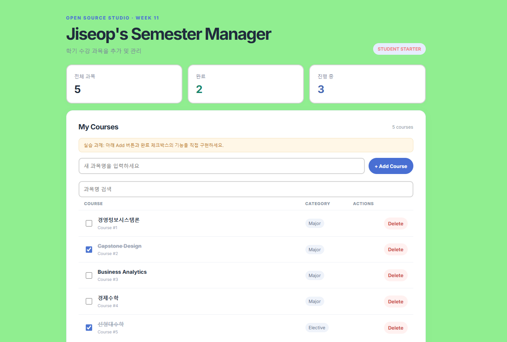
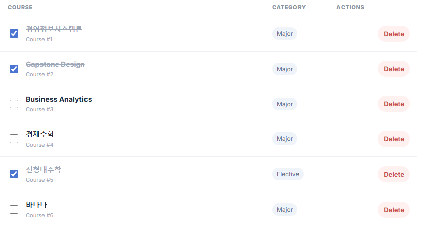
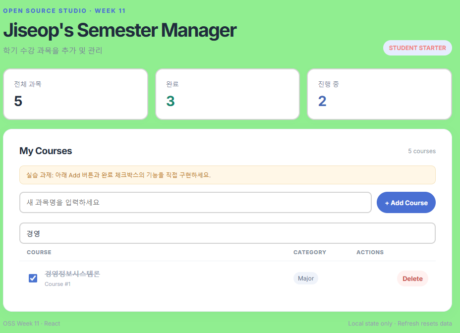
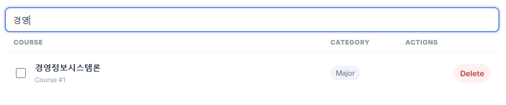

# OSS Week 11 — Jiseop's Semester Manager

## 1. Project Information

- 프로젝트 소개 : React + Vite 기반 수강 과목 관리 Project입니다. 
- 주요 기능 : 과목 등록, 완료 상태 변경, 삭제, 검색을 제공합니다.
- 원본 Sample Project URL : https://github.com/2026-2-OSS/week11_sample_project

## 2. Installation

Node.js 20.19+ 또는 22.12+ 권장.

```bash
npm install
npm run dev
```



브라우저에 표시되는 Local URL에 접속하세요. 빌드 테스트: `npm run build`.

## 3. Source Code Exploration

**주요 파일**
- `src/App.jsx`: 페이지 전체 레이아웃
- `src/components/CourseList.jsx`: State 및 목록, 삭제 / 추가 / 검색 로직
- `src/components/CourseItem.jsx`: Props로 데이터를 받고 이벤트 콜백 호출
- `src/data/courses.js`: 초기 과목 데이터
- `src/App.css`: 전체 디자인

**Component와 Props 관계**
- CourseList가 course, onDelete, onToggle을 props로 CourseItem에 전달하면, 자식은 데이터를 직접 바꾸지 않고, 이벤트가 발생하면 부모의 함수를 호출한다. 

**useState 및 Event 분석**
- courses : 과목 배열 state, newName : 입력창 값, keyword : 검색어
- onSubmit(과목 추가), onChange(입력창 값 반영), onToggle(체크박스 클릭), onDelete(삭제 버튼 클릭)

**주요 코드 2개 설명**

1. 목록 렌더링과 Props 전달 : courses(검색 결과는 visibleCourses)를 map()으로 순회하며 과목마다 CourseItem을 만들고, 과목 데이터와 이벤트 함수를 props로 전달한다. 

```javascript
{visibleCourses.map((course) => (
  <CourseItem
    key={course.id}
    course={course}
    onDelete={handleDelete}
    onToggle={handleToggle}
  />
))}
```

2. handleDelete : 삭제할 과목을 제외한 새 배열을 filter()로 만들고 setCourses()로 교체한다. 삭제 전에 window.confirm()으로 사용자 확인을 받는다.

```javascript
function handleDelete(id) {
  if (!window.confirm("이 과목을 삭제하시겠습니까?")) return;
  setCourses((previous) => previous.filter((course) => course.id !== id));
}
```

## 4. Customizing
**수정한 데이터** : 초기 과목 5개 -> 경영정보시스템론, Capstone Design, Business Analytics, 경제수학, 선형대수학

**텍스트** : 제목 `My Course Manager` → `Jiseop's Semester Manager`, 설명 `학기 수강 과목을 추가 및 관리`

**스타일 및 파일명(App.css)**
- `:root` - background : #f5f7fb -> lightgreen
- `.tag` - color : #4568b4 -> lightcoral
- `.stat` - border : 1px solid #e7ebf1 -> 2px solid lightgrey
- `.panel` - padding : 25px -> 32px
- `.input` - border : 1px solid #d9e1ee -> 2px solid lightgrey
- `.btn` - border-radius : 9px -> 999px

## 5. Feature Extension

### 기능 1. 과목 등록
```javascript
function handleAdd(event) {
  event.preventDefault();
  const name = newName.trim();
  if (!name) return;
  const newCourse = {
    id: courses.length > 0 ? Math.max(...courses.map((c) => c.id)) + 1 : 1,
    name,
    category: "Major",
    completed: false,
  };
  setCourses((prev) => [...prev, newCourse]);
  setNewName("");
}
```
- 동작 결과


### 기능 2. 완료 상태 변경
```javascript
function handleToggle(id) {
  const newCourses = courses.map((course) => {
    if (course.id === id) return { ...course, completed: !course.completed };
    return course;
  });
  setCourses(newCourses);
}
```
- 동작 결과


### 기능 3. 과목명 검색
```javascript
const searchText = keyword.trim().toLowerCase();
const visibleCourses = courses.filter((course) =>
  course.name.toLowerCase().includes(searchText)
);
```
- 동작 결과


## 6. Deployment
- Vercel URL : https://2026-oss-assign4-3.vercel.app/

## 7. Weekly Review
**새롭게 배운 내용 3가지**
1. useState로 현재 값과 변경 함수를 함께 선언하고, 변경 함수로 값이 바뀌면 React가 컴포넌트를 다시 랜더링해 화면을 갱신한다는 것을 배웠습니다.
2. Props를 통해 부모가 자식에게 데이터와 함수를 전달하고 자식은 이벤트가 발생하면 전달받은 함수를 호출해 부모의 state를 바꾼다는 것을 배웠습니다.
3. onClick 때 화살표 함수를 붙이지 않고 사용할 경우 함수가 즉시 실행되어 이벤트가 발생했을 때 정상으로 동작이 되지 않을 수 있다는 것을 배웠습니다.

**어려웠던 점과 해결 방법**
새 과목의 고유 id를 어떻게 해야 할지 어려움이 있었습니다. 그래서 AI의 도움을 받아 Math.max(...)를 사용하여 현재 가장 큰 id에 1을 더하는 방식으로 해결했습니다.  

**AI 활용 내용 및 느낀 점**
1. 프로젝트 코드 중 CourseList.jsx를 분석할 때 각 주요 코드가 어떤 내용인지 설명해달라고 부탁했습니다. 
2. Math.max(...)을 사용하여 고유 id 생성하는 것에 도움을 받았습니다. 
3. handleToggle()의 객체 복사 방식에서 {...course, completed: !course.completed }로 기존 과목을 복사한 뒤 completed 값만 바꾸는 방법을 알게 되었습니다.

- 느낀 점 : 처음에는 코드 전체를 직접 보면서 분석했고 그 다음으로 AI와 함께 다시 코드를 확인하여 시간을 많이 썼다고 생각이 들지만 그만큼 얻는 것도 많다고 생각합니다. 그리고 아무것도 없는 상태에서 코드를 작성하는 것은 어려웠을 것 같은데 기본으로 제공되는 코드들을 참고하여 스스로 시도해보기도 하면서 배우는 것이 많았습니다. 

> 교육 목적의 로컬 State 앱입니다. 서버 API 및 데이터베이스는 사용하지 않습니다.
